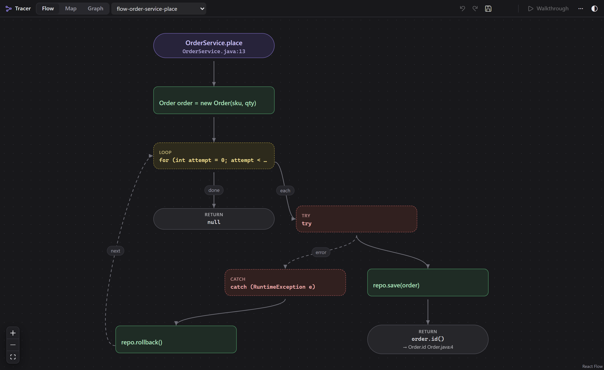
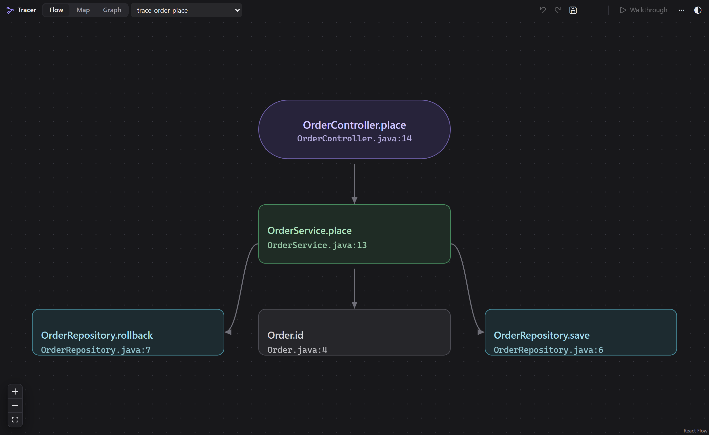
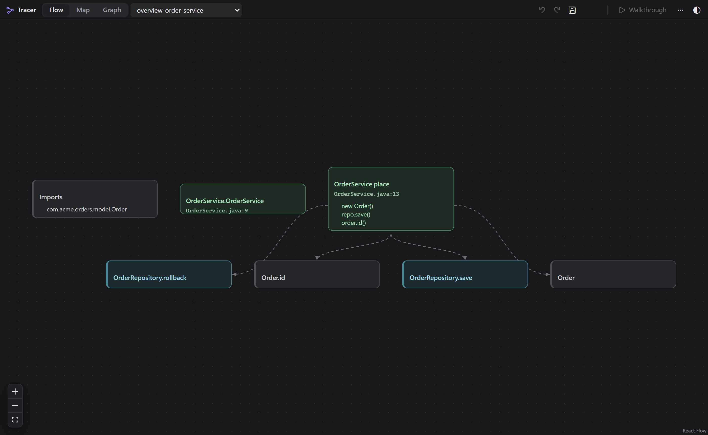
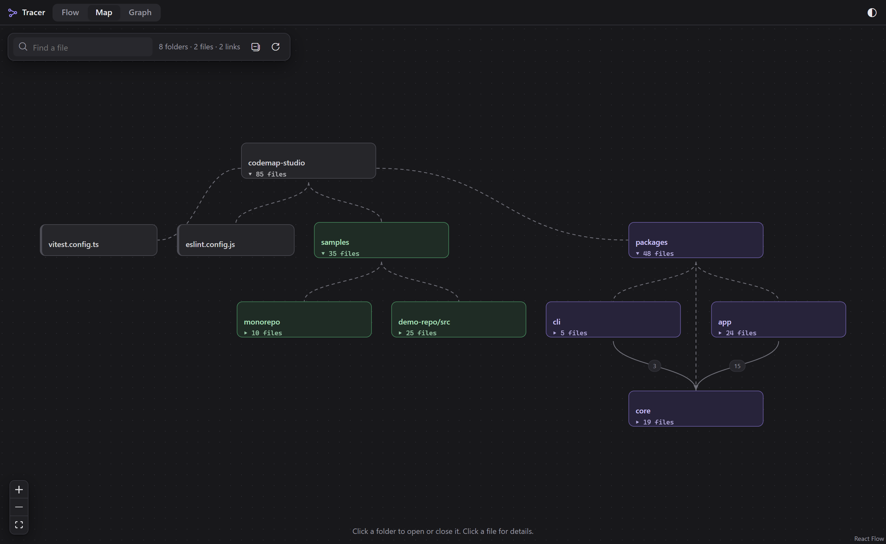
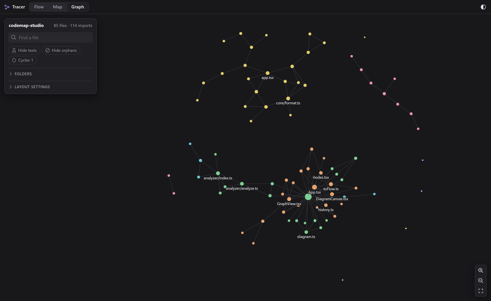
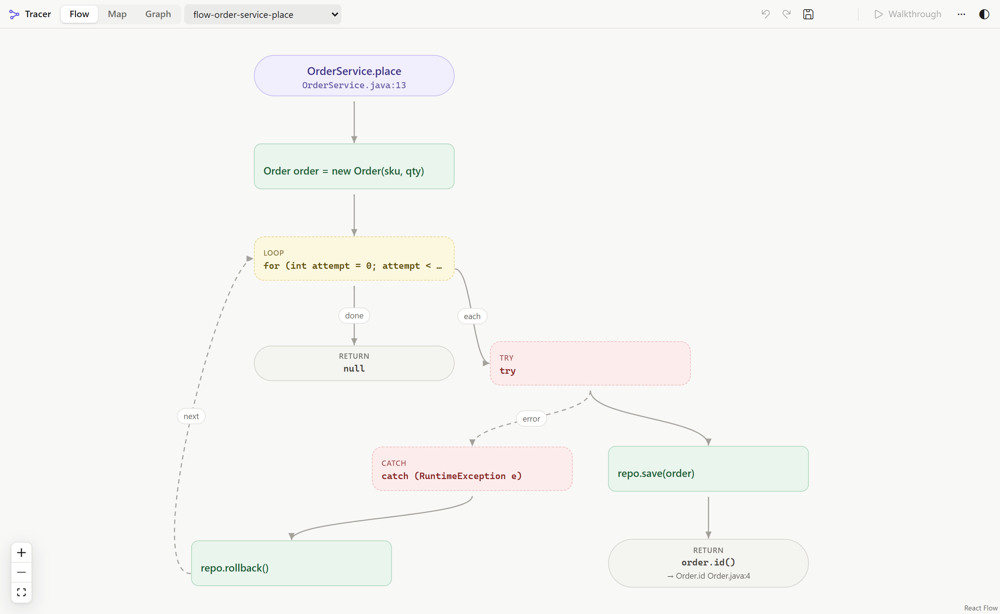

# Tracer: Code Flow & Map

**Understand any code in seconds. Right-click a function, see its flow.**

Flowcharts of your functions, the call chain across files, and an interactive map of your whole repository, in 19 languages, built right into VS Code.

**100% local. No AI. No network. No telemetry.**

## Why Tracer

Reading unfamiliar code means holding branches, loops and calls in your head. Tracer draws them for you, from the code itself, so a pull request, a legacy method or a new microservice makes sense in a minute instead of an hour.

- **No setup.** Install, right-click, done. No configuration, no account, no API key.
- **Private by design.** Your code never leaves your machine. Tracer makes no network requests at all, and uses no AI service.
- **Any language, any size.** 19 languages, 10-service workspaces, files of 15,000 lines.
- **Fast.** The diagram appears immediately; a 15,000-line file takes well under a second.
- **Yours to keep.** Save a diagram as a `.diagram.json` file, edit it, or export PNG, SVG and JSON Canvas.

## Features

### Show Flow of a function

Put the cursor in a function, right-click, **Tracer → Show Flow**. You get its `if`/`else`, loops (with the back-edge), `switch`/`match`, `try`/`catch`/`finally`, `return` and `throw`, one card per step. Calls that resolve to code in your workspace link to their definition: click the card, then **Open source**.

Select a few lines and run **Show Flow** to draw just those lines.

### Trace calls across files

**Tracer → Trace Calls From This Function** follows the call chain through your workspace (Controller → Service → Repository), coloured by role, up to the depth you set.

### File overview

Right-click a file in the explorer for a map of its functions: who calls whom inside the file, and what it reaches in other files.

### Map your repository

Open the **Tracer** icon in the activity bar, or run **Tracer: Open Map**. Folders are cards; click one to open or close it. Imports between folders are rolled up with a count (`app → core: 15`). Click a file to light up what it imports and what imports it. Services (a `package.json`, `pom.xml`, `go.mod`, `*.csproj`…) are marked automatically, which makes a ten-service workspace readable at a glance.

### The graph

The **Graph** tab is the free-moving view of every file: hover to highlight neighbours, drag to rearrange, search, hide tests and orphans, highlight import cycles. It glides smoothly even with thousands of files.

### Light and dark

Diagrams follow your VS Code theme, or force one with the `tracer.theme` setting.

## Get started in 30 seconds

1. Install Tracer and open a project.
2. Open a code file and click inside a function.
3. Right-click → **Tracer → Show Flow**.

| I want to… | Do this |
| --- | --- |
| Understand a function | Cursor in it → right-click → **Tracer → Show Flow** |
| Understand a few lines | Select them → **Tracer → Show Flow** |
| See what a function ends up calling | **Tracer → Trace Calls From This Function** |
| Understand a file | Right-click it in the explorer → **Tracer → Show Flow** |
| See how a repo is organised | **Tracer** icon in the activity bar, or **Tracer: Open Map** |
| Keep a diagram | **Save** in the flow panel (writes `*.diagram.json`) |

## Languages

| Depth | Languages |
| --- | --- |
| **Deep**: flows, calls and imports linked across files | TypeScript, JavaScript (JSX/TSX), Java, Kotlin, Python, Go, C# |
| **Standard**: functions, calls, imports, control flow | Rust, C, C++, PHP, Ruby, Swift, Scala, Dart, Lua, Zig |
| **Any other file** | Shown in the map and graph |

## Settings

| Setting | Default | What it does |
| --- | --- | --- |
| `tracer.theme` | `auto` | `auto` follows VS Code; or force `light` / `dark` |
| `tracer.flow.traceDepth` | `4` | How many call levels **Trace Calls** follows (1–8) |

## Reading a flow

- **Rounded top card**: the function and where it lives.
- **Dashed card**: a decision (`if`, `switch`, a loop). Arrows are labelled `yes` / `no`, the case, `each`, `done`.
- **Plain cards**: steps. A resolved call shows `→ Class.method  File.ext:line`.
- **Red cards**: `throw` / `raise` and error paths.

Flows show the **structure** of your code. Nothing is guessed or written for you.

## Privacy and permissions

Tracer is built so you can run it on code you cannot share.

| | |
| --- | --- |
| Network | **None.** No requests; the webview's Content-Security-Policy allows no `http(s)` source. No remote scripts, fonts or images. |
| AI / telemetry | **None.** Nothing is collected or sent. |
| Activation | Only when you open the Tracer view, run one of its commands, or open a `*.diagram.json` / `*.canvas` file. |
| Files read | Source files, build manifests, `tsconfig.json` and the root `.gitignore` of your workspace, skipping `node_modules`, `dist`, `build`, `.git`, virtual environments and other caches. Kept in memory only. |
| Files written | A diagram only when you save it. Exports only where you choose. |
| Files opened | **Open source** opens files inside the workspace only. |
| Restricted Mode | Works in untrusted workspaces: it only reads files. |

## Good to know

- Control flow is read from the code's syntax. Lambdas and callbacks passed to `map`, `forEach`, `each` read as part of their function; other callbacks (route handlers, hooks, tests) get flows of their own.
- Calls are linked to definitions by name and receiver. Very common names (`get`, `add`…) and ambiguous matches are left unlinked rather than guessed.
- Calls between services over HTTP or gRPC are not linked.
- Very large files: the overview shows the first 60 functions and says how many more there are.
- Elixir files appear in the map and graph; their flows are not drawn yet.

## Troubleshooting

- **No Tracer entry in the right-click menu**: the file type may not be supported, or reload the window (Ctrl+Shift+P → *Developer: Reload Window*).
- **"There is no function at the cursor"**: click inside a function and try again.
- **Calls into other files are not linked on the first flow**: Tracer is still reading a large workspace in the background. Run Show Flow again in a moment.
- **Anything else**: open the **Tracer** output channel (View → Output) and [report it](https://github.com/prasanna-cw/Tracer/issues/new?template=bug_report.md) with a small code sample.

## Feedback and contributing

Tracer is open source (MIT): [github.com/prasanna-cw/Tracer](https://github.com/prasanna-cw/Tracer). Bug reports, ideas and pull requests are welcome; see [CONTRIBUTING](https://github.com/prasanna-cw/Tracer/blob/main/CONTRIBUTING.md). If Tracer saves you time, a ⭐ on GitHub and a rating on the Marketplace help others find it.
